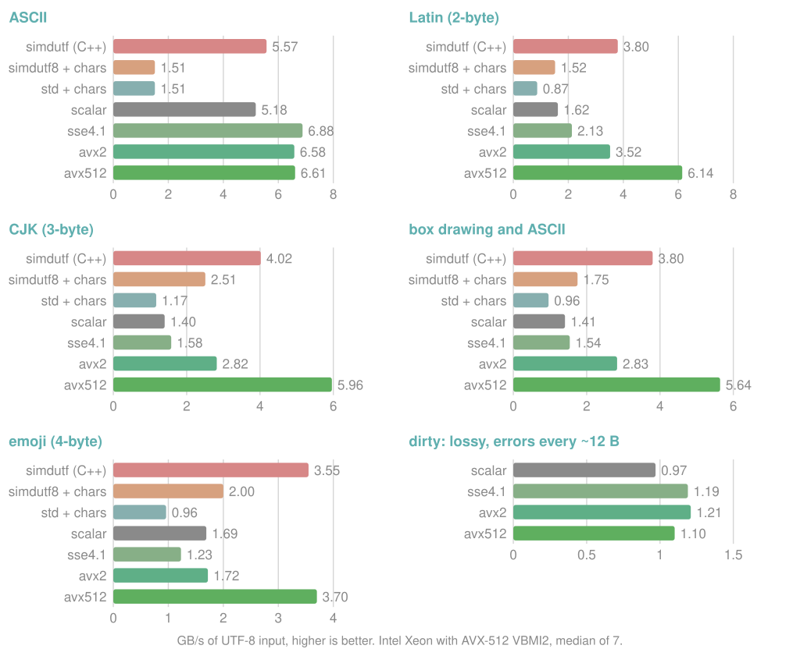
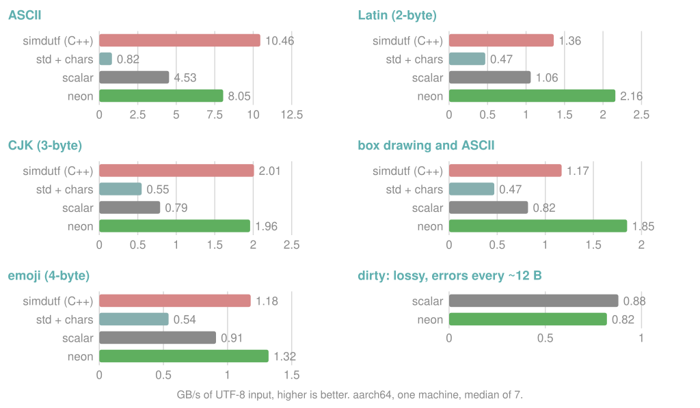

# utf8-to-utf32

This crate converts UTF-8 to UTF-32 in pure Rust. It validates as it converts and uses SIMD kernels for SSE4.1, AVX2 and AVX-512 (chosen at runtime on x86/x86_64) and NEON (on aarch64). It has no C or C++ dependencies.

- **Strict conversion.** Errors follow `core::str::from_utf8` exactly (`valid_up_to`, `error_len`, maximal-subpart lengths), and the error also reports how many code points were written.
- **Lossy conversion.** Each maximal invalid subpart becomes one U+FFFD, which gives the same output as `String::from_utf8_lossy`. An optional *C1 mode* passes a lone `0x80..=0x9F` byte through as its raw value, which is what terminal emulators want for C1 controls.
- **Chunk decoder** (`Decoder` / `Piece`). It splits input into ASCII runs, decoded runs, invalid subparts, and a truncated tail that you carry over to the next read.

## Usage

```toml
[dependencies]
utf8-to-utf32 = "0.1"
```

```rust
use core::mem::MaybeUninit;
use utf8_to_utf32::{utf8_to_utf32, utf8_to_utf32_lossy_into, Decoder, Piece};

// Strict: dst must be at least src.len() long.
let src = "│ build ✓ ok".as_bytes();
let mut dst = vec![MaybeUninit::<u32>::uninit(); src.len()];
let n = utf8_to_utf32(src, &mut dst).unwrap();

// Lossy, with raw C1 controls.
let mut out = Vec::new();
utf8_to_utf32_lossy_into(b"a\x9bb\xff", &mut out, true);
assert_eq!(out, [0x61, 0x9b, 0x62, 0xFFFD]);

// Chunk decoder (lending style: Wide borrows the decoder's buffer).
let mut dec = Decoder::new();
let mut pieces = dec.pieces(b"some ascii output...\xe2\x94\x80\xe2\x94");
while let Some(p) = pieces.next_piece() {
    match p {
        Piece::Ascii(bytes) => { /* fast path */ }
        Piece::Wide(cps) => { /* code points */ }
        Piece::Invalid(bytes) => { /* U+FFFD or C1 */ }
        Piece::Incomplete(tail) => { /* keep for the next read */ }
    }
}
```

There are explicit-level variants (`*_with(Level, ..)`) for testing and benchmarking. With `std`, the `UTF32_LEVEL=scalar|sse4.1|avx2|avx512|neon` environment variable sets the default level.

## Implementations

| Level | CPU features | Block | Fast paths |
|---|---|---|---|
| `Scalar` | none | none | 8-byte ASCII widening, then one character at a time |
| `Sse41` | SSSE3, SSE4.1, POPCNT | 16 B | ASCII widening; blocks with only 1–3-byte characters decoded as 8 u16 lanes; general blocks as 4 u32 lanes (x86/x86_64) |
| `Avx2` | AVX2, POPCNT | 32 B | the same, with 16 u16 lanes or 8 u32 lanes (x86/x86_64) |
| `Avx512` | AVX-512 F, BW, VBMI, VBMI2 | 48 B | the same, with 32 u16 lanes (`vpcompressw`) or 16 u32 lanes (`vpcompressd`) (x86/x86_64) |
| `Neon` | NEON | 64 B | ASCII widening; Keiser–Lemire `tbl` validation; blocks with only 1–3-byte characters decoded in the byte domain (16 positions per vector, `vsli` bit-inserts), 4-byte characters add a third output byte; compaction by `tbl` straight into u32 lanes (aarch64) |

The x86 kernels validate with bitmasks built from byte comparisons. A block is valid when its continuation bytes are exactly the ones its lead bytes claim, it has no C0, C1 or F5+ leads, and the second byte after E0, ED, F0 or F4 is in range. A block that fails this check is decoded by the scalar path, which reports the exact error. Inputs with many errors therefore run at roughly scalar speed. The NEON kernel validates with lookup tables instead; when a block fails, it still decodes the characters before the first bad lane with SIMD, then lets the scalar path resolve one character before SIMD resumes.

## Features

- `std` (default): runtime CPU detection and `UTF32_LEVEL`. It implies `alloc`.
- `alloc`: the Vec-based APIs (`utf8_to_utf32_lossy_into`, `Decoder`).
- Without `std`, the crate is `no_std`. The level comes from compile-time target features, for example `-C target-feature=+avx2`.

The minimum supported Rust version is **1.89**, the release that stabilized the AVX-512 intrinsics. aarch64 uses the NEON kernel; other non-x86 targets use the scalar path.

## Performance

These numbers come from **one machine**: an Intel Xeon with AVX-512 VBMI2 (the CPU model string just says "Intel(R) Xeon(R) Processor"), measured on 2026-11-14 with Rust 1.99.1, an LTO release build and default `RUSTFLAGS`, so runtime dispatch is in use. Each figure is GB/s of UTF-8 input, the median of 7 runs over inputs of about 1 MB. Run-to-run noise is about 5–10%. Run `cargo run --release -p utf32-bench` to reproduce them.

| GB/s | ascii | latin | cjk | box drawing | dirty (box + C1 + 0xFF) |
|---|---|---|---|---|---|
| simdutf 0.7 (C++) `convert_utf8_to_utf32_with_errors` | 5.24 | 3.80 | 3.99 | 3.80 | – |
| simdutf8 + `chars()` | 1.45 | 1.59 | 2.48 | 1.74 | – |
| std `from_utf8` + `chars()` | 1.50 | 0.93 | 0.97 | 0.94 | – |
| `utf8_chunks` + `chars()` (C1) | 0.52 | 0.59 | 0.98 | 0.65 | 1.04 |
| this crate, scalar | 5.22 | 1.34 | 1.08 | 1.07 | 0.96 |
| this crate, sse4.1 | 6.54 | 1.55 | 1.59 | 1.29 | 1.06 |
| this crate, avx2 | 6.52 | 2.77 | 2.81 | 2.70 | 1.09 |
| this crate, avx512 | 6.76 | 5.23 | 4.81 | 4.63 | 1.04 |

The "dirty" column uses lossy conversion in C1 mode. The other columns use the strict slice function. The `bench/` directory has the full output, including the `Decoder` rows and a `-C target-cpu=native` run. These figures have not been checked on AMD or on other Intel generations.



### aarch64 (NEON)

Measured on one aarch64 Linux machine (ARMv8.x with `i8mm`/`bf16`, no SVE; CPU model not identified), Rust 1.100, LTO release build, same method as above. See `bench/results/neon.md` for the full output.

| GB/s | ascii | latin | cjk | box drawing | emoji | dirty |
|---|---|---|---|---|---|---|
| simdutf 0.7 (C++) | 10.15 | 1.33 | 2.01 | 1.11 | 1.19 | – |
| std `from_utf8` + `chars()` | 0.82 | 0.47 | 0.55 | 0.47 | 0.54 | – |
| this crate, scalar | 4.51 | 1.06 | 0.79 | 0.82 | 0.91 | 0.88 |
| this crate, neon | 7–9 | 2.16 | 1.96 | 1.85 | 1.32 | 0.82 |

"Dirty" input (an error every ~12 bytes) is the one case where NEON is slightly slower than scalar; after an error the kernel backs off to scalar for a growing stretch. ASCII varies by about 20% between builds with code layout.



## Documentation

- [docs/architecture.md](docs/architecture.md): layers, dispatch, the kernel contract, the scalar module and the `Decoder`.
- [docs/architecture/x86.md](docs/architecture/x86.md): the SSE4.1, AVX2 and AVX-512 kernels.
- [docs/architecture/aarch64.md](docs/architecture/aarch64.md): the NEON kernel, including measurements and ideas that were evaluated.

## License

Licensed under either of [Apache License, Version 2.0](LICENSE-APACHE) or [MIT license](LICENSE-MIT), at your option.
