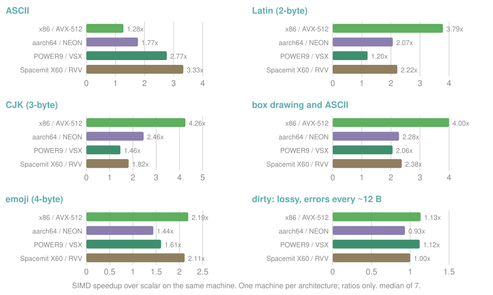

# utf8-to-utf32

[](#license)
[](https://crates.io/crates/utf8-to-utf32)
[](https://docs.rs/utf8-to-utf32)

This crate converts UTF-8 to UTF-32 in pure Rust, validating as it goes. It uses SIMD kernels on supported platforms and has no C or C++ dependencies.

- **Strict conversion.** Errors follow `core::str::from_utf8` exactly (`valid_up_to`, `error_len`, maximal-subpart lengths), and the error also reports how many code points were written.
- **Lossy conversion.** Each maximal invalid subpart becomes one U+FFFD, which gives the same output as `String::from_utf8_lossy`. An optional *C1 mode* passes a lone `0x80..=0x9F` byte through as its raw value, which is what terminal emulators want for C1 controls.
- **Chunk decoder** (`Decoder` / `Piece`). It splits input into ASCII runs, decoded runs, invalid subparts, and a truncated tail that you carry over to the next read.

## Usage

```toml
[dependencies]
utf8-to-utf32 = "0.2"
```

```rust
use core::mem::MaybeUninit;
use utf8_to_utf32::{utf8_to_utf32, utf8_to_utf32_lossy_into, Decoder, Piece};

// Strict: dst must be at least src.len() long.
let src = "│ build ✓ ok".as_bytes();
let mut dst = vec![MaybeUninit::<u32>::uninit(); src.len()];
let n = utf8_to_utf32(src, &mut dst).unwrap();

// Lossy, with raw C1 controls.
let mut out = Vec::new();
utf8_to_utf32_lossy_into(b"a\x9bb\xff", &mut out, true);
assert_eq!(out, [0x61, 0x9b, 0x62, 0xFFFD]);

// Chunk decoder (lending style: Wide borrows the decoder's buffer).
let mut dec = Decoder::new();
let mut pieces = dec.pieces(b"some ascii output...\xe2\x94\x80\xe2\x94");
while let Some(p) = pieces.next_piece() {
    match p {
        Piece::Ascii(bytes) => { /* fast path */ }
        Piece::Wide(cps) => { /* code points */ }
        Piece::Invalid(bytes) => { /* U+FFFD or C1 */ }
        Piece::Incomplete(tail) => { /* keep for the next read */ }
    }
}
```

There are explicit-level variants (`*_with(Level, ..)`) for testing and benchmarking. With `std`, the `UTF32_LEVEL=scalar|sse4.1|avx2|avx512|neon|vsx` environment variable sets the default level.

## Implementations

| Level | CPU features | Block | Fast paths |
|---|---|---|---|
| `Scalar` | none | none | 8-byte ASCII widening, then one character at a time |
| `Sse41` | SSSE3, SSE4.1, POPCNT | 16 B | ASCII widening; blocks with only 1–3-byte characters decoded as 8 u16 lanes; general blocks as 4 u32 lanes (x86/x86_64) |
| `Avx2` | AVX2, POPCNT | 32 B | the same, with 16 u16 lanes or 8 u32 lanes (x86/x86_64) |
| `Avx512` | AVX-512 F, BW, VBMI, VBMI2 | 48 B | the same, with 32 u16 lanes (`vpcompressw`) or 16 u32 lanes (`vpcompressd`) (x86/x86_64) |
| `Neon` | NEON | 64 B | ASCII widening; Keiser–Lemire `tbl` validation; blocks with only 1–3-byte characters decoded in the byte domain (16 positions per vector, `vsli` bit-inserts), 4-byte characters add a third output byte; compaction by `tbl` straight into u32 lanes (aarch64) |
| `Vsx` | VSX (nightly, `vsx` feature) | 64 B | the NEON design with `vec_perm` lookups and compaction; SWAR movemask; POWER9 `lxv`/`stxv` (POWER9 only) |
| `Rvv` | RVV (nightly, `rvv` feature, V extension) | vl B | SEW=8 validation, SEW=32 code-point arithmetic and `vcompress` compaction (riscv64) |

## Features

- `std` (default): runtime CPU detection and `UTF32_LEVEL`. It implies `alloc`.
- `alloc`: the Vec-based APIs (`utf8_to_utf32_lossy_into`, `Decoder`).
- Without `std`, the crate is `no_std`. The level comes from compile-time target features, for example `-C target-feature=+avx2`.

The minimum supported Rust version is **1.89**, the release that stabilized the AVX-512 intrinsics. aarch64 uses the NEON kernel; POWER9 can enable the VSX kernel with `--features vsx` on a nightly toolchain (POWER8 falls back to scalar); riscv64 can enable the RVV kernel with `--features rvv` on a nightly toolchain; other non-x86 targets use the scalar path.

## Performance

SIMD levels reach up to 4.45x scalar, with one error-dense case slightly slower. The graph compares each level to scalar on the same machine; full tables, per-architecture notes and the raw results are in [docs/performance.md](docs/performance.md).

| Speedup over scalar | ASCII | Latin | CJK | box | emoji | dirty |
|---|---|---|---|---|---|---|
| x86 / AVX-512 | 1.30x | 3.90x | 4.45x | 4.33x | – | 1.08x |
| aarch64 / NEON | 1.77x | 2.07x | 2.46x | 2.28x | 1.44x | 0.93x |
| POWER9 / VSX | 2.77x | 1.20x | 1.46x | 2.06x | 1.61x | 1.12x |
| Spacemit X60 / RVV | 2.47x | 2.22x | 1.82x | 2.38x | 1.44x | 1.00x |



Against other implementations on the same machine, our SIMD levels lead on every
input class except NEON ASCII and CJK, where simdutf C++ is ahead in the recorded
run; the ASCII ordering is not stable across builds on that machine. See the
[cross-implementation graph](docs/performance-competitors.svg) and its table in
[docs/performance.md](docs/performance.md#versus-other-implementations).

## Documentation

- [docs/performance.md](docs/performance.md): benchmark method, full tables and the cross-architecture summary.
- [docs/architecture.md](docs/architecture.md): layers, dispatch, the kernel contract, the scalar module and the `Decoder`.
- [docs/architecture/x86.md](docs/architecture/x86.md): the SSE4.1, AVX2 and AVX-512 kernels on x86 and x86_64.
- [docs/architecture/aarch64.md](docs/architecture/aarch64.md): the NEON kernel, including measurements and ideas that were evaluated.
- [docs/architecture/ppc64.md](docs/architecture/ppc64.md): the VSX kernel, its SWAR masks and the measured `Decoder` cost on error-dense input.
- [docs/architecture/riscv.md](docs/architecture/riscv.md): the RVV kernel, its inline-asm design and the VLA block contract.

## Acknowledgements

Some RVV kernel optimizations (the signed-byte non-continuation mask and the
1-2/1-3 byte decode fast paths) are inspired by [Olaf Bernstein’s `rvv-bench`
`vector-utf`](https://github.com/camel-cdr/rvv-bench/blob/main/vector-utf/8toN_gather.c)
([article](https://camel-cdr.github.io/rvv-bench-results/articles/vector-utf.html),
MIT). No code was copied from `rvv-bench`.

## License

Licensed under either of [Apache License, Version 2.0](LICENSE-APACHE) or [MIT license](LICENSE-MIT), at your option.
