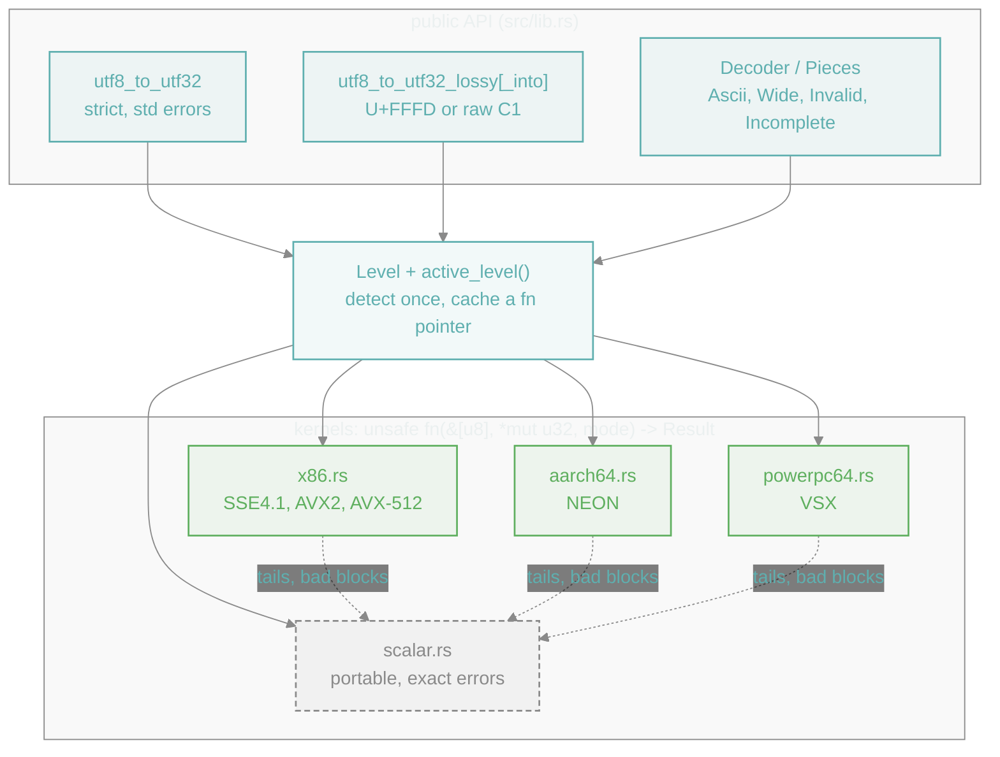
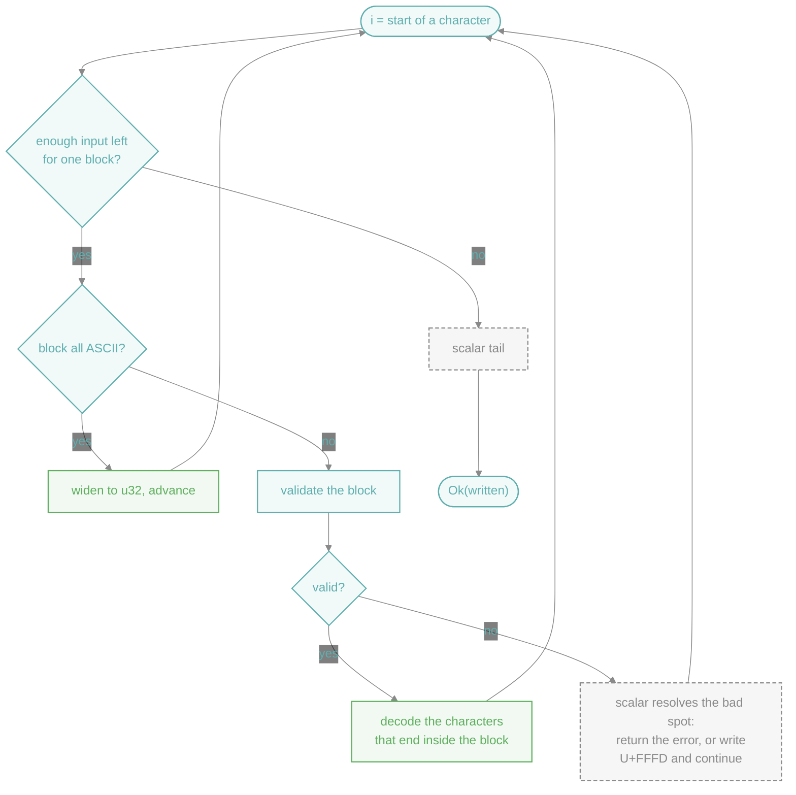
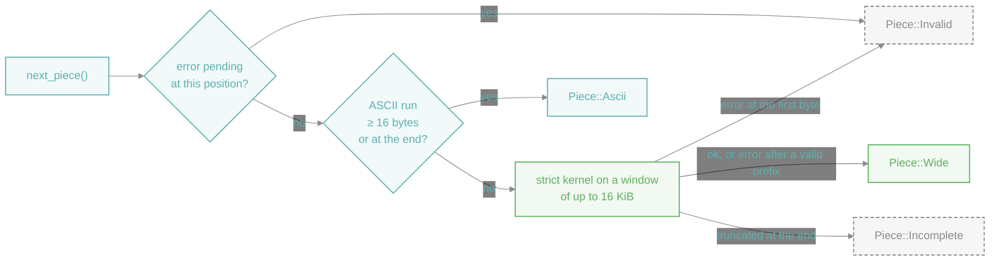

# Architecture

How the crate turns UTF-8 into UTF-32: the public layers, how a kernel is
chosen, what every kernel has to do, and where to look for each architecture.

- [x86 / x86_64](architecture/x86.md): SSE4.1, AVX2 and AVX-512 kernels.
- [aarch64](architecture/aarch64.md): the NEON kernel.
- [powerpc64](architecture/ppc64.md): the VSX kernel (nightly, `vsx` feature).

The diagrams use mermaid. Teal boxes are the main path, green boxes are
decoding, and dashed grey boxes are fallbacks.

## Layers



Every public function ends up in one *kernel*, a function of this shape:

```rust
type Kernel = unsafe fn(&[u8], *mut u32, u8) -> Result<usize, Utf32Error>;
```

The third argument is the *mode*: `STRICT` returns the first error, `LOSSY`
replaces each maximal invalid subpart with U+FFFD, and `LOSSY_C1` also lets a
lone `0x80..=0x9F` byte through as its raw value. The mode only matters when
an error is met, and errors are always resolved by the scalar code, so the
SIMD kernels do not need to know about it beyond passing it on.

## Dispatch

`Level` lists the implementations (`Scalar`, `Sse41`, `Avx2`, `Avx512`,
`Neon`, `Vsx`). `Level::is_supported` uses runtime detection with `std` and
compile-time target features without it. `active_level()` picks the best
supported level, or the one named by `UTF32_LEVEL`, and caches it. The kernel
pointer is cached in an `AtomicPtr`, so the hot path is one relaxed load and
one indirect call. The `*_with(Level, ..)` functions skip the cache and are
what the tests and benchmarks use.

## What a kernel must do

All kernels, whatever the architecture, follow the same contract and the
same overall loop:



Three rules hold for all of them:

1. **A block starts on a character boundary.** The kernel never begins in the
   middle of a character, so validation never has to look at bytes before the
   block. A character cut by the end of the block is left for the next block
   (the block is shortened), never decoded early.
2. **The scalar code owns the error semantics.** A kernel only decides *that* a
   block is bad. The exact `valid_up_to`, `error_len` and the lossy
   replacement all come from `scalar::run` and `scalar::step`, which follow
   `core::str::from_utf8` byte for byte.
3. **Output stores are wider than the output.** Compaction writes a whole
   vector and then advances `o` by the number of characters, so garbage lands
   past `o` and is overwritten by the next store. That is why `dst` must be at
   least `src.len()` long even when fewer code points result: every store stays
   below `i + block`, and `o <= i` always holds because a character is at least
   one byte. A kernel also stops one block early (the *lookahead*) so
   unaligned loads never leave `src`.

## The scalar module

`src/scalar.rs` is both the fallback level and the error resolver.

| Function | Role |
|---|---|
| `decode_one` | Decodes one non-ASCII character. Returns the code point and length, or `Err(Some(n))` for an invalid subpart of `n` bytes, or `Err(None)` for a valid but truncated tail. The range checks after `E0`, `ED`, `F0` and `F4` live here. |
| `run` | Decodes characters from `i` until `i >= until`, widening 8 ASCII bytes at a time. Stops with the exact error. |
| `step` / `fix` | In strict mode returns the error. In lossy modes writes U+FFFD (or the raw C1 byte) and returns the position after the invalid subpart. |
| `finish` | The scalar tail loop used when a kernel runs out of blocks. |
| `ascii_len` | Length of the leading ASCII run, used by the `Decoder`. |

A kernel calls `step(run(src, i, end, dst, o), ..)` whenever it gives up on
SIMD, and carries on from the position and output index it returns.

## The `Decoder`

`Decoder` wraps a kernel for terminal-style use. It owns a scratch `Vec<u32>`
and a `Pieces` cursor over one input:



A window that fails after a valid prefix is returned as a `Wide` piece, and
the error becomes the *pending* piece for the next call. Each error therefore
costs one extra kernel call. This is the reason the `Decoder` is slow on input
with an error every few bytes (see the performance sections of the
per-architecture pages).

Counting the calls makes the cost concrete. On the `bench/` dirty input (an
error every ~12 bytes, 820 KiB) there are 30,000 errors and **60,000 kernel
entries**, one for the `Wide` prefix and one that resolves the pending
`Invalid`.

Each entry receives a window of 16 KiB but the kernel stops at the first
error, so only the first block of that window does any work. Feeding the
`Decoder` a lossy kernel, or adding a mode that returns all pieces of a window
in one call, would remove those re-entries; both change the kernel contract
and are design decisions rather than fixes to this loop.

## Tests and benchmarks

| Path | What it covers |
|---|---|
| `tests/conformance.rs` | Every supported level against `core::str::from_utf8`, `utf8_chunks` and the lossy modes, on random and structured inputs, with block-boundary sweeps. |
| `tests/exhaustive_neon.rs` | Every 3-byte combination at several offsets, and sampled 4-byte tails, against `std`. It runs every supported level, not only NEON, and is the check to run after touching any validator. |
| `bench/` | `utf32-bench` compares all levels with simdutf (C++), simdutf8 and `std`. `bench/results/` keeps the output per machine. |

VSX is gated behind the `vsx` Cargo feature and needs a nightly toolchain;
on every other target, and on stable builds, the level is absent and the tree
builds unchanged.
