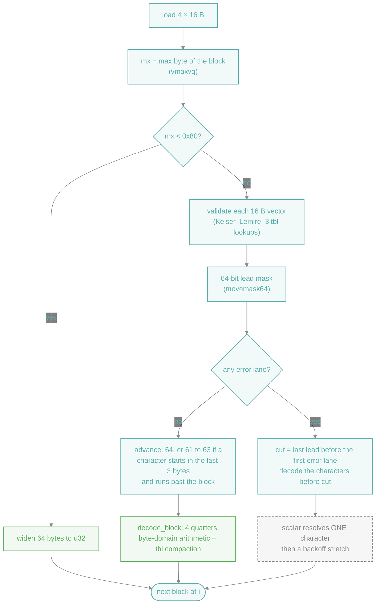
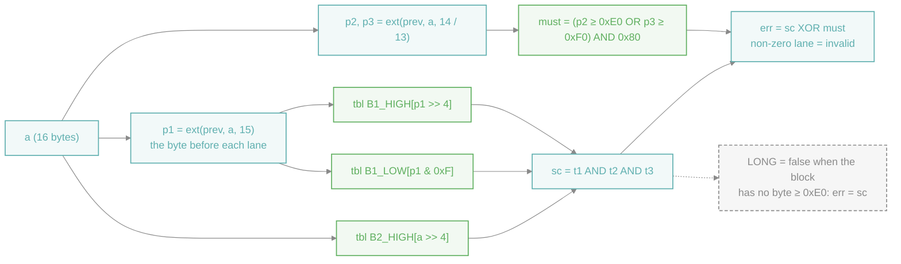
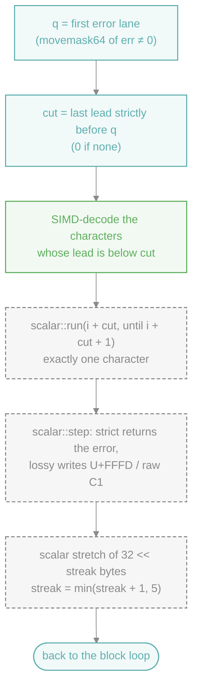
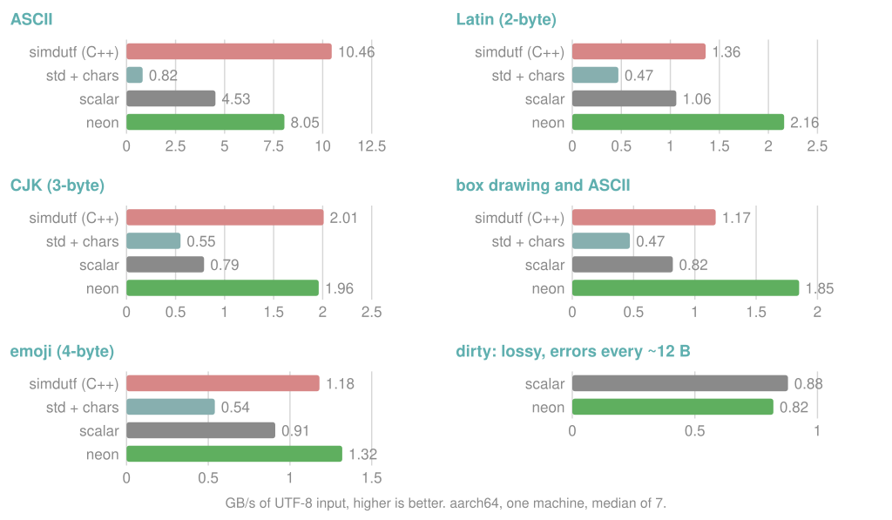

# aarch64: the NEON kernel

`src/aarch64.rs` holds one kernel, `neon_impl`. It does not reuse the bitmask
validator of the [x86 kernels](x86.md). NEON has no `movemask` and no
`vpcompress`, so a design that builds half a dozen masks per block and
compacts with a mask register would spend most of its time moving data
between the vector and scalar units. This kernel keeps validation and
arithmetic in the vector domain and crosses to scalar once per block.

## Overview

The input is processed in **64-byte blocks**. The loop runs while
`i + 80 <= len`: 64 bytes for the block and 16 for the lookahead of the
decoders' shifted loads. What is left (at most 79 bytes) goes to the scalar
tail.



### Invariants

- **Blocks start on a character boundary.** `i` only ever lands on one: after
  a block it advances by 64 or by the shortened amount, and after an error it
  is whatever `scalar::run` returns. Validation can therefore start with an
  all-zero "previous bytes" vector and never needs state from the last block.
- **`o <= i`.** Each character is at least one byte. Every compaction store
  writes at most 8 u32 past `o`, so with `o <= i + 56` at the last group of
  the block, the highest address written is below `i + 64 <= len`, inside
  `dst` (which is at least `src.len()` long).
- **Nothing is written for a block that fails validation, except its valid
  prefix.** Validation finishes before the first decode store.

## Validation

Each 16-byte vector `a` is checked together with the bytes before it
(`prev`, the previous vector, or zero for the first). The scheme is the
lookup validator of Keiser and Lemire: three table lookups, one per property,
ANDed.



Every table entry is a set of error classes (`TOO_SHORT`, `TOO_LONG`,
`OVERLONG_2/3/4`, `SURROGATE`, `TOO_LARGE`, `TWO_CONTS`, ...). An error class
only survives the AND when all three nibble lookups agree, which is exactly
when the pair of bytes is invalid in that way. `must` handles the case the
pair lookups cannot see: the byte two or three positions after a 3- or 4-byte
lead must be a continuation, and the `TWO_CONTS` bit in `sc` says whether this
lane *is* one, so the XOR is non-zero on a mismatch in either direction.

Two points matter for correctness:

- A truncated character at the end of the vector is **not** an error here: no
  lane after it exists to expose it. The block-advance rule below leaves such a
  character for the next block, where it is checked against its real
  continuation bytes.
- If the block has no byte `>= 0xE0`, `p2` and `p3` cannot be 3- or 4-byte
  leads, so `must` is zero and `validate::<false>` skips the two extra `ext`s
  and the saturating subtracts. That is what makes Latin text about 15%
  faster.

`tests/exhaustive.rs` checks these tables against `std` for every
3-byte combination at offsets that straddle the vector boundaries.

## The lead mask

The only scalar value needed per block is a 64-bit mask with a bit per byte
that *starts* a character. `cont = (byte as i8) < -64` is true for
`0x80..=0xBF`, so `leads = !movemask64(cont)`.

NEON has no `movemask`. `movemask64` ANDs each compare result with the weights
`1, 2, 4, ..., 128, 1, 2, ...` and folds four vectors with a tree of
`vpaddq_u8`:

```text
t0..t3 = cmp & weights
pa = paddq(t0, t1)        pb = paddq(t2, t3)
pc = paddq(pa, pb)        pd = paddq(pc, pc)      low 64 bits = the mask
```

Four `vpaddq` and one lane move replace what was sixteen `vgetq_lane`
extractions per mask in the first version of the kernel.

## Advancing

A character that starts inside the block but ends beyond it cannot be decoded
yet, because its tail has not been validated. Its start is found from the last
three bytes only, with no dependency on the vector work:

| Condition | Advance |
|---|---|
| `b[63] >= 0xC0` | 63 |
| else `b[62] >= 0xE0` | 62 |
| else `b[61] >= 0xF0` | 61 |
| otherwise | 64 |

(Any of these leads that is *invalid* is reported by the next block, where it
sits at position 0.) The decode mask is `leads & ((1 << adv) - 1)`. About 1 to
2 bytes of 64 are validated twice as a result. In exchange, the loop-carried
dependency is a short chain of loads and compares, so consecutive blocks
overlap in the out-of-order window.

## Decoding

The mask says *where* characters start. Decoding is done for **every** byte
position as if it started a character, and the mask then selects the lanes
that are kept. Wrong lanes (continuation bytes) compute garbage that is
discarded.

### Byte domain, for characters of up to 3 bytes

For a quarter (16 positions) the kernel loads `a`, `v1` (shifted by 1) and `v2`
(shifted by 2) as 16 u8 lanes and computes the **high and low byte of the
16-bit code point** in the byte domain, so one instruction processes 16
positions instead of 8:

| Length | Low byte | High byte |
|---|---|---|
| 1 | `a` | 0 |
| 2 | `(a << 6) \| (v1 & 0x3F)`, one `vsli` | `(a >> 2) & 0x07` |
| 3 | `(v1 << 6) \| (v2 & 0x3F)`, one `vsli` | `(a << 4) \| ((v1 & 0x3C) >> 2)` |

The lane's length class comes from two compares (`a >= 0xC0`, `a >= 0xE0`),
used as `vbsl` selectors. `vsli` (shift left and insert) does the "shift one
byte into the bits above the low six of the other" without a separate mask.

```mermaid
%%{init: {"theme":"base","themeVariables":{"fontFamily":"ui-sans-serif,system-ui,Segoe UI,Helvetica,Arial,sans-serif","primaryColor":"#5fafaf14","primaryBorderColor":"#5fafaf","primaryTextColor":"#5fafaf","lineColor":"#8a8a8a","textColor":"#8a8a8a","edgeLabelBackground":"transparent"}}}%%
flowchart LR
    classDef teal fill:#5fafaf14,stroke:#5fafaf,stroke-width:1.5px,color:#5fafaf
    classDef green fill:#5faf5f14,stroke:#5faf5f,stroke-width:1.5px,color:#5faf5f
    classDef grey fill:#8a8a8a14,stroke:#8a8a8a,stroke-width:1.5px,stroke-dasharray:5 3,color:#8a8a8a

    in["a, v1, v2<br/>16 lanes each"]:::teal
    lh["lo, hi bytes per position<br/>vsli + vbsl on length class"]:::green
    zip["zip1 / zip2<br/>two vectors of 8 u16 code points"]:::green
    tbl["tbl with TBL_PAIRS[mask8]<br/>selected u16s → u32 lanes"]:::green
    st["store 4 + 4 u32<br/>o += CNT8[mask8]"]:::teal
    garbage["lanes past o:<br/>overwritten by the next store"]:::grey

    in --> lh --> zip --> tbl --> st
    st -.-> garbage
```



### Compaction

`zip1`/`zip2` interleave the low and high bytes into two vectors of eight
u16 code points. For each group of 8 positions, `TBL_PAIRS[mask8]` holds two
`tbl` index vectors that pick the (lo, hi) bytes of the k-th selected position
into the low two bytes of u32 lane `k % 4` and `0xFF` (which `tbl` turns into
zero) in the upper two. So one `tbl` both **compacts** and **widens**: the
result is ready to store as four u32. The first vector yields characters 0 to 3
of the group, the second characters 4 to 7.

Two details save time:

- The advance of `o` comes from `CNT8`, a 256-byte population-count table. On
  aarch64 `u8::count_ones` goes through the vector unit (`fmov`, `cnt`, `addv`,
  `fmov`); a load is cheaper.
- The second store of a group is skipped when the group has 4 or fewer
  characters, which is common for 3-byte text.

The tables are `const fn` generated: `TBL_PAIRS` is 256 × 32 B = 8 KiB and
`TBL_U32` is 16 × 16 B.

### Quarters with 4-byte characters

If a quarter contains a byte `>= 0xF0`, `decode_wide` runs instead. It computes
a third byte per position (bits 16 to 20, from `a` and `v1`), widens the three
bytes to u32 with `zip` and compacts four positions at a time with
`TBL_U32[mask4]`. It is slower per byte than the 3-byte path, but only the
quarters that need it pay for it (`mx < 0xF0` skips the per-quarter test for
the whole block).

## Failing blocks

When validation finds an error lane, the kernel does not give up on the block:



**Why every character before `cut` is valid.** The validator reports a problem
at the byte where it becomes visible, never later than the byte after the bad
character, so the first error lane `q` belongs to a character that starts at
the last lead before `q` or earlier. Taking `cut` as that lead (instead of
`q`) and decoding only leads below it is therefore safe, and it is
conservative in at most one valid character, which scalar redoes.

**Progress.** `scalar::run` with `until = i + 1` always decodes at least one
character (or one 8-byte ASCII chunk), so the loop advances even when
`cut == 0`.

**Backoff.** Inputs with errors every few bytes would pay for a failed
validation, a prefix decode and a restart on every error. After an error block
the kernel runs scalar for `32 << streak` bytes (capped at 1 KiB), where
`streak` counts consecutive error blocks and is reset to zero by any block that
validates. Dense errors converge to scalar speed. An isolated error costs one
64-byte block and a 32-byte scalar stretch.

## Measured behaviour

All numbers are GB/s on one aarch64 machine, from `bench/results/neon.md`
(ARMv8.x with `i8mm`/`bf16`, no SVE; CPU model not identified).

| | ascii | latin | cjk | box | emoji | dirty |
|---|---|---|---|---|---|---|
| first NEON version (bitmasks) | 1.40 | 0.35 | 0.30 | 0.25 | – | 0.18 |
| scalar | 4.52 | 1.06 | 0.78 | 0.82 | 0.91 | 0.88 |
| **this kernel** | 8.02 | 2.19 | 1.92 | 1.87 | 1.31 | 0.82 |
| simdutf 0.7 (C++) | 9.70 | 1.36 | 2.01 | 1.11 | 1.19 | – |



"Dirty" is lossy mode with C1 passthrough on input with an error every ~12
bytes. ASCII is strongly build-dependent here: four runs of the same code put
this kernel at 7.6–9.0 GB/s and simdutf at 7.0–10.5 GB/s, so either row can come
out ahead. The other classes vary by a few hundredths.

### Where the time goes

Measured with throw-away kernels (validation replaced by a constant, or
decoding replaced by a popcount) on the version before the last three tweaks:

| Part | Share of kernel time per 64 B |
|---|---|
| validation | about 26% |
| decode and compaction | about 50% |
| loads, lead mask, advance | about 25% |

### Ideas that were evaluated

| Idea | Outcome |
|---|---|
| Replace `vgetq_lane` extractions with a `vpaddq` movemask | 6 times faster on ASCII, 2.5 times on text. The first fix. |
| Bitmask validation as in the x86 kernels | Dropped: 5 to 11 masks per block, each a compare, AND and a three-level `vpaddq` chain. |
| `CNT8` instead of `count_ones` | Kept: 3 to 5%. |
| Skip the second compaction store when the group has ≤ 4 characters | Kept: CJK 1.90 to about 2.0, others unchanged. |
| `validate::<false>` for blocks below `0xE0` | Kept: Latin 1.87 to 2.17. |
| Specialize uniform 3-byte quarters, skipping the `m2`/`m3` selects | Rejected. Detecting them needed an extra `movemask64` over four vectors, which cost more than the selects it removed: CJK 1.97 to 1.83, and every other class was slower too. A class signal has to come from masks the validator already computes, as on x86. |
| Length-pattern tables (12-bit lead pattern → shuffle, as in simdutf) | Not built. The decomposition above bounds the gain: it would replace the two-`tbl` compaction but not the arithmetic, estimated at 0 to 10% for a 64 KiB table, serial steps and shorter advances on 3-byte text. |
| SVE2 `COMPACT` | Not tried: no hardware with SVE available for testing, and the SVE intrinsics are not stable in Rust. It is the closest analogue of AVX-512 `vpcompress`. |

### Known weak spots

- **Error-dense input** is a little slower than scalar (0.82 against 0.88).
- **The `Decoder`** is much slower than scalar on such input (0.21 against
  0.33): it asks the kernel for a window and gets back one error per call, so
  every error costs a kernel entry. Fixing it would need the `Decoder` to
  consume lossy output directly.
- **4-byte text** (emoji) is 1.3 GB/s, about two thirds of the 3-byte rate, because
  `decode_wide` does a third byte and a 4-position compaction.
