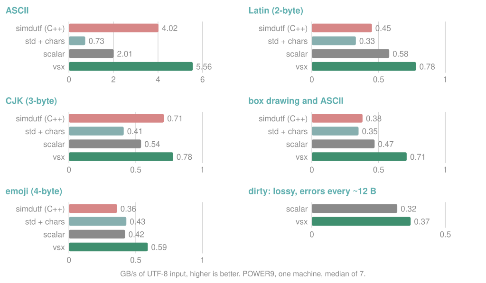

# powerpc64: the VSX kernel

`src/powerpc64.rs` holds one kernel, `vsx_impl`. It is gated behind the `vsx`
Cargo feature and needs a nightly toolchain (`stdarch_powerpc` and
`powerpc_target_feature`). Default stable builds do not compile it.

The design mirrors the [NEON kernel](aarch64.md): 64-byte blocks that start on
a character boundary, Keiser–Lemire lookup validation, one 64-bit lead mask,
byte-domain decoding and table-driven compaction. PowerPC has no `movemask`
intrinsic, so the 16-bit masks come from a SWAR multiply on the compare bytes.

## Overview

The loop runs while `i + 80 <= len`: 64 bytes for the block and 16 for the
decoders' shifted loads. Anything shorter goes to the scalar tail.

1. An all-ASCII block is widened with four `vec_perm` tables, four bytes to four
   u32 lanes each.
2. Otherwise each 16-byte vector is validated against its predecessor with
   three `vec_perm` table lookups (plus two shifts and two saturating
   subtracts when the block has a byte `>= 0xE0`). The lead mask is built by
   comparing the block as signed bytes: `0x80..=0xBF` is `-128..=-65`, so one
   `vec_cmpgt` against `-64` marks continuations.
3. A character cut by the end of the block shortens the advance to 63, 62 or
   61 bytes, decided from the last three bytes. The next block starts at its
   lead.
4. Quarters without a byte `>= 0xF0` decode in the byte domain: high and low
   bytes of every candidate code point, then two `vec_perm` interleaves and a
   mask-indexed compaction straight into u32 lanes. Quarters with 4-byte leads
   add a third byte and compact four positions at a time.
5. A failing block decodes the valid prefix, then `scalar::run`/`step` resolve
   one character and cover a growing stretch (32 bytes, doubled per consecutive
   failing block, capped at 1 KiB) before SIMD retries.

## Masks without movemask

`vec_cmpgt` leaves 0x00 or 0xFF in each byte. AND with 0x80 extracts the high
bit, giving a 64-bit integer whose byte `k` is either 0 or `1 << (8k)`. Reading
the two halves little-endian and multiplying each by `0x0002040810204081`
moves bit `7 + 8k` into bit `k` of the top byte. Two multiplies produce one
16-bit mask per vector; four vectors give the 64-bit lead mask.

## Measured behaviour

Measured on `sol`, a POWER9 ppc64le machine, with Rust 1.102 nightly, LTO
release and the `vsx` feature. Each figure is GB/s of UTF-8 input, the median
of 7 runs of about 1 MB. The full table, including the other implementations,
is in `bench/results/ppc64.md`; it was produced with
`cargo +nightly run --release -p utf32-bench --features utf8-to-utf32/vsx`.

| GB/s | ascii | latin | cjk | box | emoji |
|---|---|---|---|---|---|
| scalar | 2.01 | 0.63 | 0.54 | 0.54 | 0.48 |
| VSX | 3.33 | 0.68 | 0.74 | 0.63 | 0.48 |

VSX wins on ASCII (1.65x), box drawing (1.17x) and CJK (1.37x); Latin and
emoji are about equal in the full bench. The first version of `decode_wide`
interleaved and compacted in two separate `vec_perm` stages (10 permutes per
quarter) and ran emoji at 0.24 GB/s, well below scalar; folding both into one
mask-indexed table (6 permutes) raised it to 0.48.

**Known weak spot:** the `Decoder` on error-dense input runs at 0.09 GB/s
against scalar's 0.18. As on NEON, it asks the kernel for a window and gets one
error per call, so every error costs a block validation and a kernel entry.
The ASCII `Decoder`, by contrast, is slightly faster than scalar (10.96 against
10.45) after moving the whole-vector ASCII test ahead of the SWAR movemask in
`ascii_len_vsx`.

## Correctness

`tests/conformance.rs` and `tests/exhaustive_neon.rs` both run every supported
level, so VSX is checked against `core::str::from_utf8` and `utf8_chunks` on
random, structured and exhaustive inputs, including block boundaries. Run
`cargo +nightly test --release --features vsx` on a powerpc64 machine after a
change to the validator, the tables or a decode path.
