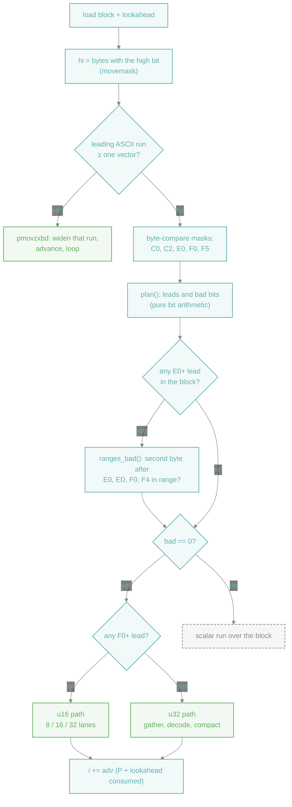
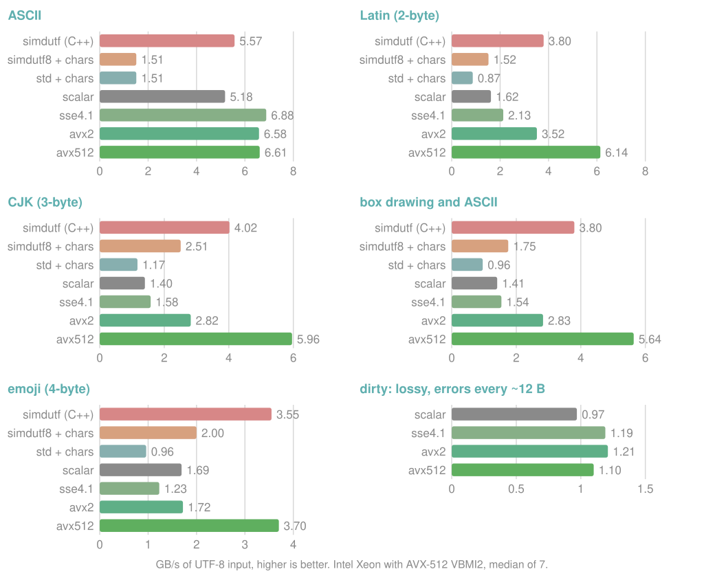

# x86 and x86_64 kernels

`src/x86.rs` holds three kernels, `sse41_impl`, `avx2_impl` and `avx512_impl`,
plus the shared bitmask logic in `src/mask.rs`. They are the same algorithm at
three vector widths. [aarch64](aarch64.md) uses a different validator, so read
this page for the *mask* design and that one for the *lookup* design.

| Kernel | Loaded per iteration | Block `P` | Lookahead | Compaction |
|---|---|---|---|---|
| SSE4.1 | 64 B (4 × 16) | 60 | 4 B (the decode loads read up to 12 B past the block, so the loop needs 72 B) | `pshufb` with a 256-entry (u16 lanes) table, also for 4-byte characters |
| AVX2 | 64 B (2 × 32) | 60 | 4 B (the decode loads read up to 12 B past the block, so the loop needs 72 B) | u16 lanes: `pshufb` per 128-bit half with the same 256-entry table; u32 lanes: `vpermd` with an 8-bit-mask table |
| AVX-512 | 64 B (1 × 64) | 60 | 4 B | `vpcompressd` / `vpcompressw` |

`P` is the number of byte positions whose characters are decoded in one
iteration. The bytes after `P` are *lookahead*: they are loaded so that a
character that starts inside the block can be decoded and validated even if it
ends outside it.

## One iteration



### Validation with bitmasks

Every compare becomes a 64-bit mask with one bit per byte. For a block of `P`
positions (`pm = (1 << P) - 1`):

- `cont = hi & !c0` marks continuation bytes (`0x80..=0xBF`).
- `claimed` marks the positions that the leads *say* must be continuations:
  `((c0 & pm) << 1) | ((e0 & pm) << 2) | ((f0 & pm) << 3)`. A 2-byte lead
  claims the next byte, a 3-byte lead the next two, a 4-byte lead the next
  three.
- `look = 7 << P` selects the lookahead positions.

The block is valid when none of these is set:

```text
(cont ^ claimed) & pm        a continuation without a lead, or a lead without its continuation
claimed & look & !cont       a claimed lookahead byte that is not a continuation
((c0 & !c2) | f5) & pm       C0 / C1 leads (overlong) and F5.. leads (above U+10FFFF)
```

`ranges_bad` adds the second-byte conditions that cannot be seen from the
masks above. After `E0` the byte must be `>= A0` (no overlong), after `ED` it
must be `< A0` (no surrogate), after `F0` it must be `>= 90`, and after `F4`
it must be `< 90`. It is only computed when the block has an `E0..` lead,
because most text does not need it.

When the block is valid, the lead mask is `!cont & pm` and the advance is
`P` plus the number of lookahead bytes the last characters claimed, so the
next block starts on a character boundary.

### Decoding

**u16 path** (no `F0` or above in the block). Code points are at most
`0xFFFF`, so each position becomes one 16-bit lane. For every position the
kernel loads the byte and the two after it, widens them to u16, and computes
the 1-, 2- or 3-byte value with shifts and blends. The lane count is 8
(SSE4.1), 16 (AVX2) or 32 (AVX-512). The lanes that start a character are
then compacted:

- SSE4.1: `pshufb` with `SSE16_TBL[mask]`, then `pmovzxwd` to u32.
- AVX2: `vpshufb` with `SSE16_TBL` looked up separately for the low and high 8 positions (one per 128-bit half). The high half is stored at `o + popcount(low)`, then both are widened.
- AVX-512: `vpcompressw` takes the lead mask directly.

**u32 path** (some `F0` or above). AVX2 and AVX-512: `pshufb` / `vpermb`
gathers bytes `j..j+3` into u32 lane `j`, `dec_*` computes the code point for
all four lengths and selects with the lead byte, and the lanes that start a
character are compacted (`vpermd` table or `vpcompressd`).

SSE4.1 does not gather. `sse41_wide` keeps 8 u16 lanes per register as in the
u16 path, adds the fourth byte, and puts bits 16–20 of 4-byte characters in a
second u16 vector. Both are compacted with the same `pshufb` and interleaved
into u32 with `punpcklwd` / `punpckhwd`. That is 8 positions per step instead
of 4, and raised emoji text from 0.96 to 1.21 GB/s on the test machine
(it stays below scalar there, which runs that ASCII-heavy text at about 1.6).
It is out of line because inlining it slowed the other inputs.

AVX-512 is the fastest because `vpcompress*` replaces the compaction tables
and the per-group popcounts with one instruction on a mask register, and
because its 60-position block amortises the validation over more bytes. All
operands come from the one 64-byte register, so the block only has to leave
room for the 3-byte lookahead; going from 48 to 60 positions raised Latin,
CJK and box drawing by about 20–30% on the test machine.

## Measured behaviour



From `bench/results/default.md`, on one Intel Xeon with AVX-512 VBMI2. The
figures have not been checked on AMD or on other Intel generations. The base
and patched builds were measured alternately in one session with `taskset`;
scalar rows moved by up to 9% without any code change, so treat small
differences as layout noise.

Moving from 48 to 60 positions on AVX-512, from 32 to 60 on AVX2, and from 16
to 60 on SSE4.1 raised Latin, CJK and box drawing by 12–27% on AVX-512, about
26% on AVX2 Latin, and up to 40% on SSE4.1 Latin. SSE4.1 emoji improved from
about 1.07 to 1.20 GB/s but remains below scalar (~1.6). The one measured
regression is SSE4.1 `Decoder pieces` on dirty input, 0.53 to 0.42 GB/s: an
error every 10–17 bytes makes each window fail its first 64-byte block, which
is more waste than the old 16-byte block, and the backoff streak restarts on
every kernel call. The slice and lossy APIs improved on dirty input at every
level.

## Ideas evaluated

- **Keiser–Lemire lookup-table validation, as on NEON/VSX/RVV.** Not ported:
  the design notes advise against moving x86 off bitmasks without a
  measurement, and none was made.
- **Byte-domain decode with compact+widen** (NEON's `TBL_PAIRS`/`CNT8`, RVV's
  `vcompress`). Adopted in part: SSE4.1's 4-byte path keeps the low 16 bits in
  one u16 vector and the top bits in a second, then interleaves on store.
- **A 64-byte block with 60 decoded positions.** Kept: this is where most of
  the gain came from. A shorter loop-carried advance from the last three
  bytes, tried instead of shortening the block, cost 20–36% in both its
  branchy and branchless forms.
- **Per-group mixed u16/u32 decode at 16 positions (SSE), SSE blocks of 20/24/
  28 positions, AVX2 blocks of 48/56 positions.** All slower or non-monotonic;
  not kept.
- **A 60-position SSE block without the u16 4-byte path, an inline SSE wide
  path, an ASCII threshold of `tz >= 16`, removing the `gm != 0` branch.**
  Cost 7–15% on at least one class each; not kept.
- **`PREFIX = true`.** Known slower from earlier work; not retried.
- **Not attempted:** lookup-table validation and a dedicated AVX-512 4-byte
  path.

## Failing blocks

When `plan` reports bad bits, the kernel calls `plan_err` to find the
characters that precede the first bad bit. The compile-time switch
`mask::PREFIX` decides what happens next. It is `false`, so the whole block
(`P` bytes) is handed to `scalar::run`. With `true`, the valid prefix would be
decoded with SIMD first and only the rest of the block would go to scalar. The
code for that is in place in all three kernels, but it is not enabled, and no
benchmark in this repository compares the two settings.

Scalar then does not stop at the first error. It runs to the end of a
*stretch* of `P << streak` bytes, resolving every error in it, where `streak`
counts consecutive failing blocks (capped at `mask::ERR_STREAK_MAX`, so at most
960 bytes) and is reset by any block that validates. Before this, the kernel
went back to SIMD after every error and validated a block that would fail
again; on the dirty bench input (an error every ~14 bytes) the stretch raised
lossy C1 throughput by 12–24% on all three levels. It is the backoff of the
NEON kernel, with the block size as the unit.

The NEON kernel does the prefix decode unconditionally and goes further: it
resumes SIMD right after the bad character instead of finishing the block in
scalar. See [aarch64](aarch64.md#failing-blocks).

## Tails

When fewer bytes remain than one iteration loads, `scalar::finish` handles
them, so a call on a short slice is entirely scalar.
