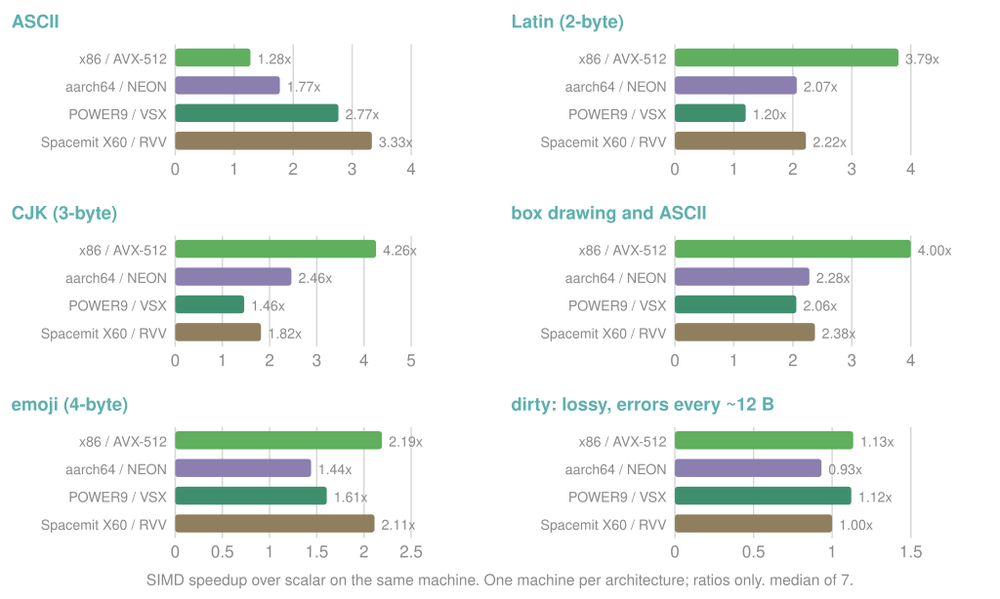
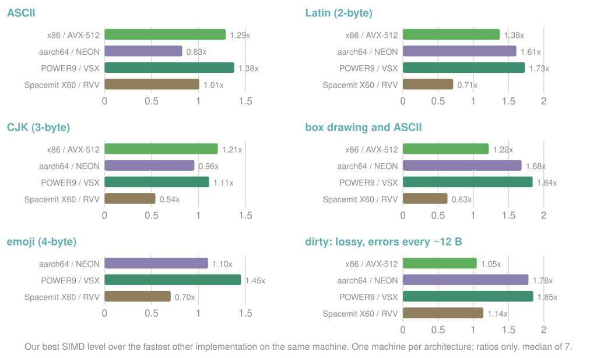
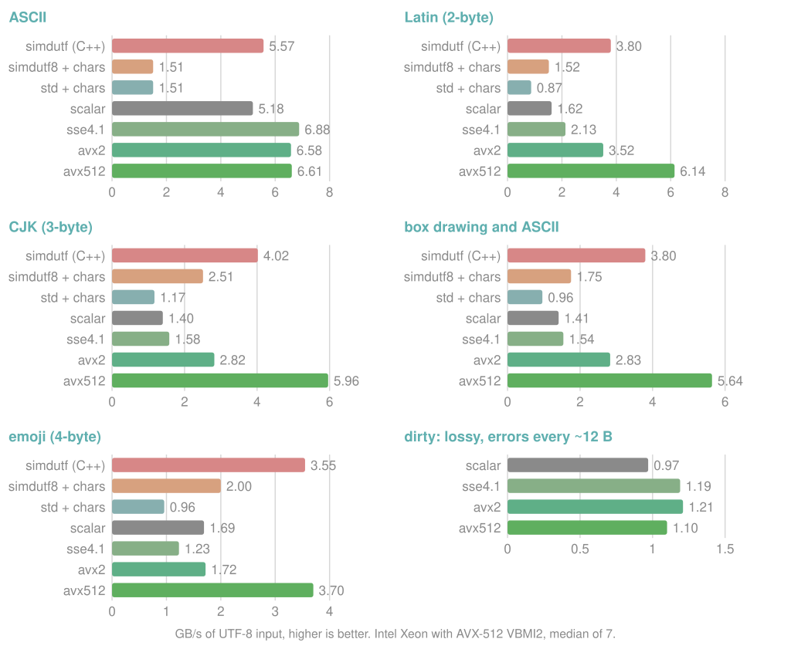
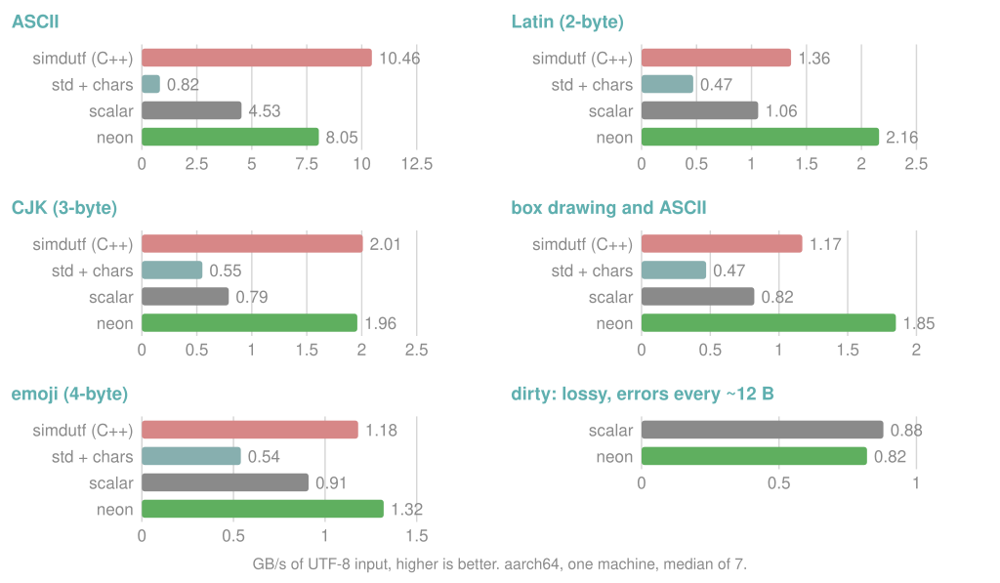
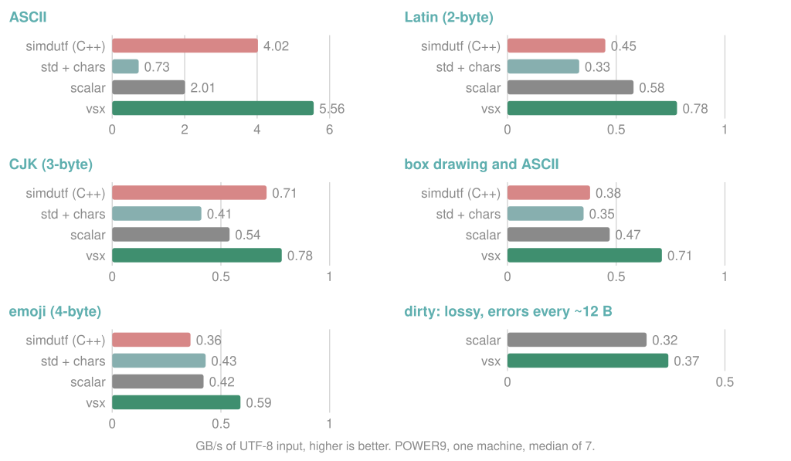
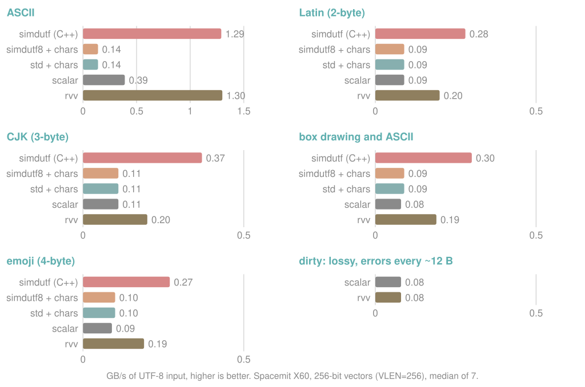

# Performance

All figures are GB/s of UTF-8 input, median of 7 runs over inputs of about 1 MB,
LTO release builds. The exact rows, including the `Decoder` and native runs, are
in [`bench/results/`](../bench/results/).

The graphs are generated by `scripts/performance.py` and
`scripts/performance_summary.py` from those result files; edit a result file or
a script, never the SVG.

## Across architectures

Each machine gets its own row, so absolute GB/s are not comparable across rows.
The graph shows the ratio to scalar on the **same** machine, which is.

| Speedup over scalar | ASCII | Latin (2-byte) | CJK (3-byte) | box drawing and ASCII | emoji (4-byte) | dirty: lossy, errors every ~12 B |
|---|---|---|---|---|---|---|
| x86 / AVX-512 | 1.32x | 3.21x | 4.86x | 3.93x | 2.27x | 1.13x |
| aarch64 / NEON | 1.77x | 2.07x | 2.46x | 2.28x | 1.44x | 0.93x |
| POWER9 / VSX | 2.77x | 1.20x | 1.46x | 2.06x | 1.61x | 1.12x |
| Spacemit X60 / RVV | 3.33x | 2.22x | 1.82x | 2.38x | 2.11x | 1.00x |

## Versus other implementations

The same result files give a like-for-like comparison against the other
libraries on each machine. Our best SIMD level is divided by the fastest of
simdutf C++, simdutf8 + `chars()` and std `from_utf8` + `chars()`; on dirty
input, where the strict rows cannot run, the competitor is `utf8_chunks` +
`chars()` (C1). simdutf8 only validates UTF-8, so its row includes std's
`chars()` conversion.

| Our SIMD vs best other | ASCII | Latin (2-byte) | CJK (3-byte) | box drawing and ASCII | emoji (4-byte) | dirty: lossy, errors every ~12 B |
|---|---|---|---|---|---|---|
| x86 | 1.36 (sse4.1 vs simdutf) | 1.51 (avx512 vs simdutf) | 1.46 (avx512 vs simdutf) | 1.50 (avx512 vs simdutf) | 0.97 (avx512 vs simdutf) | 1.18 (avx2 vs utf8_chunks) |
| aarch64 / NEON | 0.83 (neon vs simdutf) | 1.61 (neon vs simdutf) | 0.96 (neon vs simdutf) | 1.68 (neon vs simdutf) | 1.10 (neon vs simdutf) | 1.78 (neon vs utf8_chunks) |
| POWER9 / VSX | 1.38 (vsx vs simdutf) | 1.73 (vsx vs simdutf) | 1.11 (vsx vs simdutf) | 1.84 (vsx vs simdutf) | 1.45 (vsx vs std) | 1.85 (vsx vs utf8_chunks) |
| Spacemit X60 / RVV | 1.01 (rvv vs simdutf) | 0.71 (rvv vs simdutf) | 0.54 (rvv vs simdutf) | 0.63 (rvv vs simdutf) | 0.70 (rvv vs simdutf) | 1.14 (rvv vs utf8_chunks) |

Each cell names both sides of the ratio. The first is our fastest SIMD level
for that class; on x86 it is AVX-512 for Latin, CJK, box and emoji, SSE4.1 for
ASCII, and AVX2 for dirty. The second is the competing implementation used as
the denominator: `simdutf` is simdutf 0.7 in C++, `std` is `from_utf8` +
`chars()`, `simdutf8` is simdutf8 + `chars()`, and `utf8_chunks` is `utf8_chunks`
+ `chars()` in C1 mode (the strict rows cannot run on dirty input). The fastest
of those on the same machine is the denominator; on this run `simdutf` wins
every clean cell except one VSX emoji cell, where `std` is faster.

A value below 1x means the named implementation was faster on that input class.
simdutf C++ beats our NEON kernel on ASCII and edges it on CJK. Its RVV backend
beats our RVV kernel on the 2- to 4-byte classes, from 1.4x on Latin to 1.9x on
CJK, but we match it on ASCII (1.01x). The RVV row needs `CXXFLAGS="-march=rv64gcv"` when building the C++
dependency; without it simdutf falls back to its generic scalar implementation.
Generated by `scripts/performance_competitors.py`.

## x86 / x86_64

One Intel Xeon with AVX-512 VBMI2 (the CPU model string only says "Intel(R)
Xeon(R) Processor"), Rust 1.99.1, default `RUSTFLAGS` and runtime dispatch,
measured on 2026-11-21/22 in a KVM guest with 8 vCPUs. The base and patched
binaries were built in the same session and run alternately with `taskset -c 3`;
code layout alone was observed to move identical scalar code by up to 30%, so
read small differences as noise. These figures have not been checked on AMD or
on other Intel generations.

| GB/s | ascii | latin | cjk | box drawing | emoji | dirty |
|---|---|---|---|---|---|---|
| simdutf 0.7 (C++) | 5.02 | 3.80 | 4.03 | 3.78 | 3.79 | – |
| simdutf8 + `chars()` | 1.50 | 1.48 | 2.53 | 1.76 | 2.07 | – |
| std `from_utf8` + `chars()` | 1.49 | 0.79 | 1.18 | 0.88 | 1.01 | – |
| `utf8_chunks` + `chars()` (C1) | 0.58 | 0.76 | 0.96 | 0.78 | 0.96 | 1.01 |
| this crate, scalar | 5.17 | 1.79 | 1.21 | 1.44 | 1.62 | – |
| this crate, sse4.1 | 6.82 | 2.11 | 1.60 | 1.54 | 1.18 | – |
| this crate, avx2 | 6.72 | 3.49 | 2.21 | 2.89 | 1.70 | – |
| this crate, avx512 | 6.80 | 5.74 | 5.88 | 5.66 | 3.67 | – |

"Dirty" uses lossy conversion in C1 mode; the other columns use the strict
slice function. The recorded run is from the patched kernels on the
`x86_64-updates` branch, including the inline scalar decode of error-dense
`Decoder` windows; the dirty `Decoder` row is now 0.79 GB/s on SSE4.1 (was
0.42 before the fix). `native.md` is from the same final build with
`-C target-cpu=native`; `native-9c9e38e.md` records the state before the
Decoder fix. Full output: [`default.md`](../bench/results/default.md),
[`native.md`](../bench/results/native.md) and
[`native-9c9e38e.md`](../bench/results/native-9c9e38e.md).

## aarch64 (NEON)

One aarch64 Linux machine (ARMv8.x with `i8mm`/`bf16`, no SVE; CPU model not
identified), Rust 1.100, same method as above.

| GB/s | ascii | latin | cjk | box drawing | emoji | dirty |
|---|---|---|---|---|---|---|
| simdutf 0.7 (C++) | 9.70 | 1.36 | 2.01 | 1.11 | 1.19 | – |
| std `from_utf8` + `chars()` | 0.82 | 0.46 | 0.55 | 0.47 | 0.54 | – |
| this crate, scalar | 4.52 | 1.06 | 0.78 | 0.82 | 0.91 | 0.88 |
| this crate, neon | 8.02 | 2.19 | 1.92 | 1.87 | 1.31 | 0.82 |

"Dirty" input (an error every ~12 bytes) is the one case where NEON is slightly
slower than scalar; after an error the kernel backs off to scalar for a growing
stretch. ASCII is strongly build-dependent on this machine: four runs of the
same code put this kernel at 7.6–9.0 GB/s and simdutf at 7.0–10.5 GB/s, so the
ordering of those two rows is not stable. The other classes vary by a few
hundredths. Full output: [`neon.md`](../bench/results/neon.md).

## powerpc64 (VSX)

One POWER9 ppc64le machine, Rust 1.102 nightly with `--features vsx`, LTO
release build, same method as above.

| GB/s | ascii | latin | cjk | box drawing | emoji |
|---|---|---|---|---|---|
| this crate, scalar slice fn | 2.01 | 0.65 | 0.54 | 0.34 | 0.38 |
| this crate, vsx slice fn | 5.56 | 0.78 | 0.79 | 0.70 | 0.61 |

The scalar rows are noisier than the VSX rows on this machine, so the per-class
ratios move between runs. The VSX `Decoder` is faster than scalar on ASCII
(13.44 against 10.45 GB/s) but about half the speed on error-dense input; see
[the VSX architecture page](architecture/ppc64.md). Full output:
[`ppc64.md`](../bench/results/ppc64.md).

## riscv64 (RVV)

Measured on one Spacemit X60 machine with 256-bit vectors (VLEN=256), Rust
1.102 nightly, `--features rvv`, LTO release build: GB/s of UTF-8 input, median
of 7 runs over about 1 MB.

| GB/s | ascii | latin | cjk | box/mixed | emoji | dirty |
|---|---|---|---|---|---|---|
| simdutf 0.7 RVV (C++) | 1.29 | 0.28 | 0.37 | 0.30 | 0.27 | – |
| this crate, scalar slice fn | 0.39 | 0.09 | 0.11 | 0.08 | 0.09 | – |
| this crate, rvv slice fn | 1.30 | 0.20 | 0.20 | 0.19 | 0.19 | – |

The RVV measurement needs `CXXFLAGS="-march=rv64gcv"` so that simdutf's own RVV
backend is compiled; without that flag its `simdutf C++ (strict)` row is the
generic scalar fallback, which is far slower and not a comparison of vector
code. Our kernel is 3.33x scalar on ASCII, about 2x on the 2- and 3-byte
classes and 2.11x on emoji. It now matches simdutf's RVV backend on ASCII
(1.30 against 1.29 GB/s); that backend — the `rvv-bench` implementation
upstreamed into simdutf — is still ahead on the 2- to 4-byte classes, from 1.4x
on Latin to 1.9x on CJK. Our kernel matches scalar on dirty lossy input; see
[the RVV architecture page](architecture/riscv.md) for the design difference
and the headroom it leaves. Full output: [`riscv.md`](../bench/results/riscv.md).

